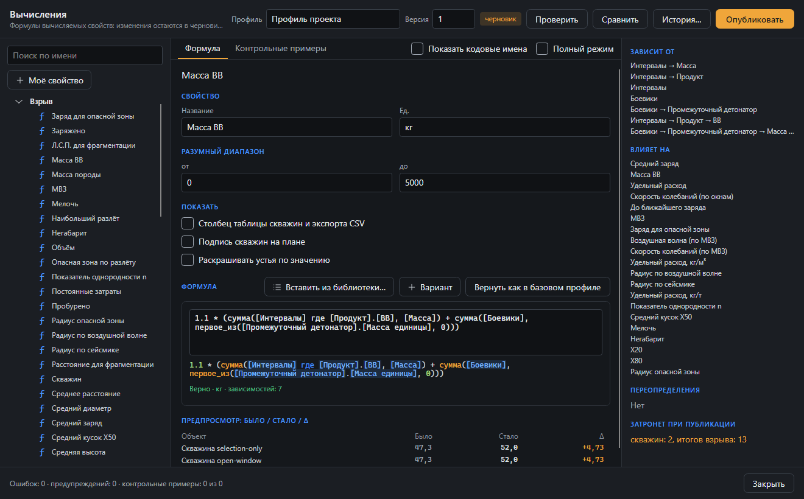

# Движок настраиваемых вычислений

Спецификация для внедрения в Blast Designer 6. Полная версия с обоснованием, инвентаризацией расчётов SHOTPlus 6 и схемами: https://claude.ai/artifact/KvoiQqdhAkSAL1ia7hAWpQ

## Цель

Расчёты Blast Designer, которые сейчас зашиты в `BlastDesigner.Engine` (Charging, Quantities, Prediction, Analysis), описываются как вычисляемые свойства сущностей с формулами на простом языке выражений. Набор формул — профиль расчёта. Встроенный профиль «SHOTPlus 6» обязан давать те же числа, что текущий код (допуск 1e-9). Алгоритмы над геометрией и графами (ячейки Вороного, Timing.Solve, линии EBS, ЛНС) остаются в коде как встроенные узлы с объявленными входами и выходами.

## Понятия

| Понятие | Что это |
|---|---|
| Контекст | тип сущности: `blast`, `site`, `holeType`, `material`, `row`, `hole`, `deck`, `charge`, `primer`, `product`, `tie`, `timingLine`, `monitor`, `surface` |
| `PropertyDef` | `id` (`hole.chargeMass`), контекст, имя RU/EN, тип (number, int, bool, string, ref, list), единица, вид (`input` / `computed` / `override`), группа, формат, min/max, встроенное или пользовательское |
| `FormulaDef` | свойство, текст выражения, условие применения (фильтр), приоритет, значение при ошибке, комментарий, источник |
| `ParameterDef` | имя (`site.vib.K`), единица, значение или таблица (ключ → значение, интерполяция), уровень переопределения: профиль → рудник → взрыв → тип скважины |
| `RuleDef` | набор правил, приоритет, условие-выражение, действие (шаблон колонки, выбор продукта, тег, запись значения), первое совпадение или все |
| `BuiltinDef` | алгоритм в коде: входы (свойства и типы сущностей), выходы, область (весь взрыв или сущность) |
| `CalcProfile` | имя, версия, базовый профиль (наследование), свойства, формулы, параметры, правила, контрольные примеры |
| `ValueOverride` | ручное значение для конкретной сущности (обобщение `ManualLoading`, `ElectronicTimeManual`) |

Поля модели (`Hole.Length`, `Deck.Top`, `Product.Density` …) регистрируются как input-свойства автоматически, отражением или явной таблицей.

Цепочка «лучшее доступное»: факт → ручное значение → формула → проектное значение типа. Параметр ищется снизу вверх: скважина → тип скважины → взрыв → рудник → профиль.

## Связи (навигация в выражениях)

| Связь | Кардинальность | Обратная | Хранение сейчас |
|---|---|---|---|
| `blast.holes`, `blast.rows`, `blast.ties`, `blast.monitors`, `blast.timingLines` | 1:N | `hole.blast` … | `BlastProject.Entities`, `Rows` |
| `hole.row` | N:1 | `row.holes` (упорядочено) | `Hole.RowId`, `HoleRow.HoleIds` |
| `hole.holeType`, `hole.material` | N:1 | `holeType.holes` | индексы 1–8 → `DesignData.HoleTypes/MaterialTypes` |
| `hole.decks` | 1:N по глубине | `deck.hole` | `Hole.Decks`; `deck.prev`, `deck.next` |
| `hole.charges` | 1:N | `charge.decks` | выводится: смежные ВВ-интервалы без инертного разделителя |
| `deck.primers` | 1:N | `primer.deck` | `Deck.Primers` |
| `deck.product`, `primer.booster`, `primer.detonator`, `tie.product` | N:1 | `product.decks` … | `ProductId` |
| `tie.from`, `tie.to` | N:1 | `hole.tiesIn`, `hole.tiesOut` | `FromId`, `ToId` |
| `timingLine.holes` | N:M | `hole.timingLine` | `TimingLineEntity.HoleIds` |
| `hole.neighbours(r)`, `hole.nearestCrest` | вычисляемая | — | пространственный индекс |

Обратная сторона нужна графу: изменили плотность продукта — пересчитываются только интервалы с этим продуктом и их скважины.

## Язык выражений

Похож на формулы Excel, без циклов и переменных (граф всегда извлекается из текста).

- арифметика, `^`, сравнения, `and`/`or`/`not`, `if(у, а, б)`, `case`, `coalesce`, `min`, `max`, `clamp`, `round`, `floor`, `ceil`, `abs`, `log10`, `ln`, `exp`, `sqrt`, `cbrt`, `pi`, `sin/cos/tan` в градусах;
- свойства текущей сущности по имени (`length`) и по связи (`product.density`, `hole.row.burden`);
- агрегаты с фильтром: `sum(decks where product.isExplosive, mass)`, `avg`, `max`, `min`, `count`, `first`;
- `param(site.vib.K)`, `lookup(table, x)`;
- встроенные функции-алгоритмы: `cellArea()`, `firingTime()`, `distToLine(crest)`, `nearest(holes, r)`, `studentT(p, df)`;
- единицы проверяются при компиляции; `to(m, diameter)` — явное приведение.

Формулы компилируются в делегаты (`System.Linq.Expressions` → `Compile`), не интерпретируются на каждом вызове.

Формулы встроенного профиля (из текущего кода):

```
deck.mass       = if(product.kind = 'GasBag', 0,
                  if(product.kind = 'Packaged' and product.unitLength > 0 and product.unitMass > 0,
                     floor(length / product.unitLength + 1e-9) * product.unitMass,
                     pi * (to(m, hole.diameter)/2)^2 * length * product.density * 1000
                       * if(product.isExplosive, hole.loadingFactor, 1)))
hole.chargeMass = sum(decks where product.isExplosive, mass) + sum(primers, booster.unitMass)
hole.volume     = cellArea() * max(0, (length - subdrill) * max(0.05, cos(angle)))
hole.tonnes     = volume * coalesce(material.density, blast.rockDensity)
blast.powderFactor = sum(holes, chargeMass) / sum(holes, volume)
blast.x50       = rockFactor * powderFactor^-0.8 * avgCharge^(1/6) * (115 / avgRws)^(19/30)
monitor.ppv     = param(site.vib.K) * (distance / sqrt(blast.mic))^(-param(site.vib.B))
```

## Граф зависимостей и пересчёт

Узел графа — пара «свойство × контекст», не каждая сущность. Значения по объектам в кэше с флагом «устарело».

Типы рёбер: та же сущность; по ссылке N:1 (через обратную связь); агрегат 1:N; параметр; пространственное (ячейка ← устья соседей); структурное (правило ← length, waterDepth, holeType); весь взрыв (`blast.mic` ← времена и заряды всех скважин).

1. При сохранении профиля: разбор, рёбра, топологическая сортировка (Кан). Цикл — ошибка с цепочкой.
2. Правка через `Document.Execute` сообщает изменённые поля объектов; движок идёт по рёбрам вниз и помечает устаревшие объекты.
3. Фаза структуры: правила заряжания и инициирования для устаревших скважин создают/удаляют интервалы и боевики. Правило не может читать то, что само создаёт. Подбор по целевому удельному расходу — отдельный итерационный решатель, не цикл.
4. Фаза значений: узлы в топологическом порядке только для устаревших объектов; независимые объекты одного уровня — параллельно.
5. Встроенные алгоритмы (ячейки, время, ЛНС) — один раз на взрыв, если устарел хоть один вход.
6. Дорогие узлы (карты PPV и фрагментации, MSW) — лениво, по запросу окна или отчёта.
7. Ошибка формулы не останавливает пересчёт: узел и зависимые получают «ошибка», скважина — тег, попадает в предупреждения.

Порядок стадий: входы → геометрия → [правила → масса и энергия] / [ячейки → объём и тонны] / [замедления связей → время] → итоги взрыва (PF, энергия, стоимость, расход, МВЗ) → прогнозы → проверки, сводная панель, подписи, отчёты.

## Редактор (Правка ▸ Вычисления…)

Окно `CalcEditorWindow` из трёх колонок, изменения в черновике профиля до «Опубликовать».

- Панель инструментов: имя профиля, версия, «черновик»; кнопки «Проверить», «Сравнить», «Опубликовать».
- Слева дерево: контексты → свойства (ƒ формула, ← ввод, «+ моё» пользовательское), параметры, наборы правил; поиск по имени; изменённые относительно базового профиля отмечены.
- В центре вкладки: Формула (имя, описание, область применения, единица и формат, текст с подсветкой и автодополнением, статус проверки, предпросмотр «было / стало / Δ» на выбранных скважинах, источник, «Вернуть как в базовом профиле»); Варианты (условие → формула, приоритет); Параметр (значения по уровням, таблица); Правило; Встроенный (входы/выходы, настраиваемые аргументы); Контрольные примеры.
- Справа: «Зависит от», «Используют», «Показать на графе», переопределения, «Затронет при публикации: N скважин, M итогов».
- Внизу строка статуса: ошибки, предупреждения, контрольные примеры.
- Проверка при наборе (300 мс). Пользовательское свойство сразу доступно в таблице скважин, подписях, раскраске, сводной панели, CSV и отчётах.

## Хранение

Профиль — файл `*.bdcalc` (JSON) в папке настроек или на общем диске; в `.bdp` записывается копия использованной версии и её хеш. Встроенный профиль «SHOTPlus 6» только для чтения, от него наследуют.

## Этапы

1. Ядро: парсер и компилятор выражений, реестр свойств и связей, граф и кэш (проект `BlastDesigner.Calc` или папка в Engine).
2. Перенос формул: Charging (масса, кг/м, забойка), Quantities (объём, тонны, итоги, стоимость, PF, энергия), Prediction (сейсмика, воздушная волна, разлёт, фрагментация, опасная зона), допуски — в профиль «SHOTPlus 6»; старые методы вызывают движок; тесты на совпадение.
3. Встроенные узлы: ячейки, время, EBS, ЛНС как `BuiltinDef`; сводная панель читает кэш.
4. Правила с условиями-выражениями; импорт старых `LoadingRule`/`InitiationRule` без потерь.
5. Редактор.
6. Расширения: имперские единицы, плотность газируемого ВВ по глубине, подбор по целевому PF.

## Решения при внедрении

Записаны по ходу внедрения (ветка `calc-engine`), где спецификация оставляла выбор или расходилась с кодом.

### Ядро (этап 1)

- **Проект.** `src/BlastDesigner.Calc` ссылается только на Domain; Engine ссылается на Calc и регистрирует в общем реестре свои алгоритмы (ячейки, время, МВЗ) и встроенный профиль. Так нет циклов, а ядро тестируется без Engine.
- **Пересчёт — вытягивающий.** Значение узла вычисляется при первом обращении и запоминается в кэше сущности (ячейка на каждое вычисляемое свойство контекста), порядок задают сами зависимости. Топологическая сортировка Кана строится при компиляции профиля: она даёт порядок стадий для редактора, «Используют» и ошибку цикла с цепочкой (`hole.a → hole.c → hole.b → hole.a`); во время вычисления цикл дополнительно ловится флагом «вычисляется». Параллельный расчёт независимых сущностей отложен: однопоточный кэш проще и уже быстрее старого кода, который пересчитывал всё на каждом обращении.
- **Изменённые поля.** `Document.Execute` хранит снимки проекта, а не список правок, поэтому вместо доработки каждой команды сеанс сам сравнивает поля модели с прошлым снимком (`CalcSession.Sync`) и инвалидирует изменившиеся вниз по рёбрам; есть и явный `Invalidate(сущность, поле)`. Изменение состава объектов или связей (новый интервал, другой ряд) сбрасывает кэш целиком — значения пересчитаются лениво. Отмена правки создаёт новый объект проекта, для него создаётся новый сеанс.
- **Обратные связи** строятся обходом прямых связей от всех сущностей зависимого контекста и кэшируются до смены состава: так один механизм покрывает рёбра «по ссылке N:1», «агрегат 1:N» и многошаговые пути (`hole.primers → booster.unitMass`).
- **Пустые значения.** Свойство несуществующего объекта (интервал без продукта) даёт NaN, `false`, пустую строку или пустой список; NaN в итоге узла — ошибка, если у формулы не задано «значение при ошибке». Ошибка узла становится значением: зависимые получают ошибку с именем источника, остальные считаются дальше (`CalcSession.Issues`).
- **Единицы.** Проверяется размерность (м, кг, с, деньги): сложение, сравнение, ветви `if`, итог против единицы свойства. Числовые константы подстраиваются под соседний операнд (`length - 0.5`). Одинаковая размерность с разным масштабом (м и мм) складывается только через `to()`. Масштаб итога против свойства не сверяется — так допустим идиом `… * product.density * 1000` для кг из г/см³. Степень размерной величины с нецелым или непостоянным показателем и эмпирические формулы получают «неизвестную» единицу `?`, совместимую с любой. `to(m, diameter)` делит на 1000, а не умножает на 0.001, — так результат побитово совпадает с `Diameter / 2000.0` в коде.
- **Вид продукта** (`product.kind`) — перечисление модели; в формулах сравнивается со строкой с именем значения перечисления (`'PackagedExplosive'`, а не `'Packaged'` из спецификации), строка проверяется при компиляции.
- **Имена полей.** Поля модели берутся отражением в camelCase; где имя занято связью, поле переименовано: `hole.holeTypeIndex`, `hole.materialIndex` (связи — `hole.holeType`, `hole.material`). Устье и забой — `hole.x/y/z`, `hole.toeX/Y/Z`. Поля `DesignData` и `CostSchema` подняты на `blast` (`blast.rockDensity`, `blast.drillingPerMetre`).
- **Контекст `charge`** (смежные ВВ-интервалы) пока не заведён: у таких групп нет устойчивой идентичности для кэша; агрегаты по `decks` покрывают текущие расчёты.
- **Параметры** ищутся: скважина → тип скважины → взрыв (значение в проекте, иначе привязанное поле модели, например `Vibration.SiteK`) → рудник → профиль.

### Профиль «SHOTPlus 6» (этап 2)

- **Где.** `src/BlastDesigner.Engine/Calc/ShotPlus6.bdcalc` — встроенный ресурс, только для чтения; `CalcService` регистрирует встроенные алгоритмы и привязки параметров, компилирует профиль, создаёт сеансы. Профиль проекта хранится в новом поле `BlastProject.Calc` (`ProjectCalc`: имя, версия, хеш, разложенная копия JSON, параметры взрыва и типов скважин, ручные значения). Поле пустое по умолчанию и не пишется в файл, поэтому старые `.bdp` открываются как раньше и считаются встроенным профилем.
- **Масса интервала** записана как `… * to(kg/m3, product.density) * …` вместо `… * product.density * 1000` из спецификации: ветви `if` обязаны иметь одну единицу, а с `to()` объёмная ветвь даёт ровно кг, как и ветвь патронов. Числа отличаются от кода только порядком умножения (≈1e-16).
- **Встроенные узлы** (`BuiltinDef`): `cellArea()` (ячейки Вороного на взрыв; настраиваемые аргументы `cellArea.holes`, `cellArea.boundary` воспроизводят прежнее поведение итогов по части скважин), `patternBurden()`, `patternSpacing()`, `mic()` (огибающая по времени с массами из кэша), `firingTime()` (Timing.Solve), `distToLine(Crest)`, `nearestChargeDistance()`, `predictPpv()` (окна замедлений, `Vibration.Predict`); функция `studentT(p, df)`. Изменения линий (граница, бровка) видны графу через вход `blast.linesKey` — отпечаток точек линий.
- **Итоги по части скважин.** Связь `blast.holes` видит отбор сеанса (`CalcScope.Subset`), поэтому `Quantities.Compute(project, subset)`, `Flyrock.Compute(project, holes)` и `Fragmentation.Compute(project, holes)` считают итоги по тем же формулам, что и весь взрыв. МВЗ, как и раньше, — по всем скважинам проекта.
- **Параметры моделей** (`Vibration`, `Flyrock`, `Fragmentation`) стали параметрами профиля `site.vib.*`, `site.flyrock.*`, `site.frag.*`, привязанными к полям модели на уровне взрыва; окна проекта по-прежнему правят поля модели. Единицы эмпирических констант — `?`.
- **Переведены на движок** с сохранением сигнатур: `Charging.DeckMass/ExplosiveMass/StemmingLength/TopStemming`, `Quantities.Compute`, `Flyrock.Compute`, `Fragmentation.Compute` (кривые строятся по X50 и n из профиля), `ExclusionZone.Compute`, `Timing.TimeEnvelope`, `Analysis.ChargeVsTime`, карта сейсмики. Формула, давшая ошибку, в старых методах возвращает 0 (как прежде отсутствующий продукт), верхняя забойка — длину скважины. Чистые функции с явными аргументами (`Vibration.Ppv`, `Flyrock.FaceBurst`, `SiteLaw.DistanceForPpv`…) оставлены: ими пользуются окна для произвольных точек и зарядов; их формулы в профиле (`monitor.ppv`, `monitor.airblastDb`, `blast.vibrationRadius`…) сверяются с ними тестами.
- **Сверка.** В `samples` нет проектов `.bdp` (только DWG), поэтому эталон — 12 сгенерированных взрывов со всеми случаями (газовый мешок, патроны, интервал без продукта, неотсортированные интервалы, фиктивные и наклонные скважины, факт. длина, коэффициент заряжания, материалы, ряды, связи, бровка и без неё, без замедлений) плюс пустой взрыв. Прежние реализации сохранены в тестах (`Legacy` в `CalcParityTests.cs`) — сверка не пропадёт после перевода. Допуск 1e-9 относительно max(1, |x|).
- **Скорость.** Короткий сеанс на каждое обращение: `ExplosiveMass` ≈ 8 мкс против ≈ 1,5 мкс прежде (компиляция профиля одна на процесс), `Quantities.Compute` на 2000 скважин — как прежде (≈ 0,5 с, время — в ячейках Вороного). Подписи плана читают массу на каждом кадре; для больших взрывов следующий шаг — долгий сеанс рядом с документом (`CalcSession.Sync` после каждой правки), из которого читают подписи и сводная панель.
- **Не перенесены** в этом этапе: допуски (`Tolerance.Check`), контекст `charge`, правила (`RuleDef`, этап 4 спецификации), `nearest(holes, r)`.

### Редактор (этап 3)



- **Окно** `CalcEditorWindow` (`src/BlastDesigner.App/Views/CalcEditorWindow.cs`), пункт «Правка ▸ Вычисления…». Три колонки: дерево (контексты → вычисляемые свойства ƒ, свои «+», поля модели ← отдельной веткой; параметры; встроенные алгоритмы; наборы правил), поиск по имени и русскому названию, точка у отличающихся от «SHOTPlus 6».
- **Черновик.** Правка встроенного профиля создаёт наследника «Профиль проекта» (`base: SHOTPlus 6`), в нём лежат только изменённые формулы, свойства и параметры; проект со своим профилем правит свою разложенную копию. «Опубликовать» — один шаг отмены: копия профиля и хеш пишутся в проект, файл `*.bdcalc` — в папку настроек (`calc\`). С ошибками компиляции публикация не проходит. Значение параметра «этот взрыв» пишется в `ProjectCalc.Parameters`.
- **Вкладки центра** сведены к двум: «Формула» (свойство, варианты «условие → формула» с приоритетом и значением при ошибке прямо в ней, источник, «Вернуть как в базовом профиле», предпросмотр «было / стало / Δ» на выделенных скважинах или первых восьми) и «Контрольные примеры» (выражение на текущем взрыве и ожидаемое значение; «Добавить с текущим значением»). Параметр и встроенный алгоритм открываются в центре своими страницами — отдельные вкладки «Параметр» и «Встроенный» не нужны. Контрольных примеров во встроенном профиле нет: пример имеет смысл только на своём эталонном взрыве.
- **Проверка при наборе**: выражение компилируется по модели черновика на каждое изменение текста (статус: единица и число зависимостей или позиция и текст ошибки), весь профиль — через 300 мс после остановки набора. Подсветка синтаксиса не сделана; вместо выпадающего автодополнения под полем показываются подходящие имена контекста (с учётом связей: `product.de…`) и функций.
- **Справа**: «Зависит от» (с путём связей), «Используют» (транзитивно), «Показать на графе» (порядок стадий узла и соседей), число ручных значений, «Затронет при публикации: N скважин, M итогов» — сравнение значений опубликованного профиля и черновика на всём проекте. Строка статуса внизу: ошибки, предупреждения, контрольные примеры.
- **Не сделано**: пользовательское свойство пока видно в движке, редакторе и предпросмотре, но не выведено в таблицу скважин, подписи, раскраску, сводную панель, CSV и отчёты — для этого нужен долгий сеанс рядом с документом (см. «Скорость»); вкладка «Правило» (правила — этап 4).

### Долгий сеанс документа и вывод свойств

- **Один сеанс на документ.** `CalcService.Attach(Document)` заводит `LiveCalc` при открытии или создании документа (`MainViewModel.Attach`). Сеанс подписан на `Document.Changed` (правка, отмена, повтор, сохранение) и синхронизируется (`CalcSession.Sync`) лениво — при первом чтении после изменения. Отмена даёт новый объект проекта, и для него заводится новый сеанс. Смена профиля, параметров проекта или ручных значений (другой хеш или содержимое `BlastProject.Calc`) тоже даёт новый сеанс. `Timing.Solve` меняет времена мимо документа, поэтому сам помечает сеанс устаревшим (`CalcService.Touch`).
- **Когда долгий сеанс не отвечает**: пока идёт правка (`Document.IsChanging` — новый флаг на время лямбды `Execute`, модель изменена наполовину); с другого потока; для сущностей, которых не было в проекте при последней синхронизации (копии окна правки, предпросмотр колонки, интервал, проверяемый с чужой скважиной). Тогда считает короткий сеанс по текущей модели, как в этапе 2. Итоги по части скважин (`Quantities.Compute`, `Flyrock/Fragmentation.Compute` с подмножеством) по-прежнему идут коротким сеансом: они меняют отбор и аргументы ячеек.
- **На долгий сеанс переведены** `Charging.ExplosiveMass/DeckMass/StemmingLength/TopStemming`, `Timing.TimeEnvelope`, `Analysis.ChargeVsTime`, заряды карты сейсмики, `ExclusionZone.Compute`. Замер (`CalcLiveTests.Benchmark_ExplosiveMass_FromTheLongSession`, 2000 скважин): долгий сеанс — 0,35 мкс на вызов, короткий — около 10 мкс, код до движка — около 3 мкс.
- **Вывод свойств.** Выбор хранится в настройках вида проекта: `ViewState.CalcColumns` (столбцы таблицы скважин и экспорта скважин в CSV; кнопка «Вычисляемые столбцы…» над таблицей), `ViewState.CalcLabels` (подписи справа от устья под обычными подписями), `ViewState.ColorBy` (раскраска устьев по значению: синий — наименьшее, красный — наибольшее среди видимых скважин; без значения — серый), `SummaryBlock.CalcTotals` (строки сводной панели взрыва и сводного блока на плане). Переключатели «Показывать» есть у каждого вычисляемого свойства в окне «Вычисления» и применяются сразу, как остальные настройки вида — без шага отмены. Поля отчётов: каждый итог взрыва доступен в штампе и колонтитуле как `{calc:blast.powderFactor}`, с единицей. Раскраски по значению раньше не было — добавлена.
- **CSV.** Вычисляемые столбцы идут после постоянных и названы своими id (`hole.volume`), числа — в инвариантной культуре, логические — 1/0, ошибка — пустая ячейка.
- **Не сделано**: вычисляемые свойства не попали в окно свойств выделенной скважины и в списки полей конструктора отчётов (поле вводится вручную); подписи вычисляемых свойств не участвуют в настройке порядка подписей (`HoleLabelLayout`) — они всегда справа, после остальных.

## Редактирование инженером

Формулы правит инженер-взрывник, а не разработчик. Поэтому окно «Вычисления» и язык формул должны позволять работать без знания кодовых имён и синтаксиса.

1. **Русские имена.** У каждого свойства, связи и функции есть русский псевдоним. Формула показывается и вводится по-русски — `[Масса ВВ]`, `сумма([Интервалы] где [Продукт].[ВВ], [Масса])`, — а хранится по кодовым именам (`hole.chargeMass`). Переключатель «Показать кодовые имена»; парсер разбирает обе записи. Псевдонимы свойств — их русские названия в реестре и профиле, псевдонимы функций и ключевых слов — таблица в ядре.
2. **Ввод без набора имён.** Двойной щелчок по свойству в дереве вставляет его в формулу. Подсказки имён под полем по мере набора; подсветка формулы: свойства — метками, функции и числа — цветом.
3. **Понятные ошибки** по-русски, с местом и подсказкой исправления. Опечатка — «возможно, вы имели в виду …» (по расстоянию Левенштейна). Свойство другого контекста — предложить путь по связи (`[Скважина].[Диаметр]`). Совместимые единицы (мм↔м, г/см³↔кг/м³) переводятся автоматически, ошибка — только для несовместимых.
4. **Конструктор условий** для вариантов формулы: таблица «свойство · оператор · значение», соединение И/ИЛИ, переключение в текстовый режим.
5. **«Объяснить значение»** из таблицы скважин: формула с подставленными числами и единицами, по шагам.
6. **Страховки.** У свойства диапазон разумных значений с предупреждением. Публикация — только после зелёных контрольных примеров и просмотра «было/стало», с причиной изменения. История версий профиля с откатом. Встроенный профиль только для чтения.
7. **Простой режим окна по умолчанию**: без встроенных алгоритмов и графа, зависимости словами («влияет на удельный расход и МВЗ»). Полный режим — переключателем.
8. **Библиотека формул**: «Вставить из библиотеки» — Кузнецов–Рам, Swebrec, Лангефорс (ЛНС), сейсмика по корню квадратному и кубическому, разлёт Richards & Moore. С описанием, источником и диапазонами коэффициентов.
9. **Таблицы параметров**: вставка из буфера обмена (из Excel) и импорт CSV.

### Решения: русские имена, ввод, ошибки, условия

- **Псевдонимы.** Свойство и связь называются в формуле своим русским названием (`NameRu` в реестре и профиле) в квадратных скобках; название, которое носят два свойства одного объекта, в имена не годится — тогда пишется кодовое имя. Поэтому у итогов стоимости названия стали полными («Стоимость продуктов» вместо «Продукты», которое совпадало со связью «Продукты»). Функции, слова и константы — таблица `Aliases` в ядре (`сумма`, `среднее`, `если`, `первое_из`, `параметр`, `в`, `и/или/не/где`, `пи`, `истина`…), встроенные алгоритмы тоже по-русски (`площадь_ячейки()`, `мвз()`). Единицы в `в(…)` пишутся и по-русски: `в(м, [Диаметр])`, `кг/м³`.
- **Хранение.** В профиле формула лежит кодовыми именами (`FormulaText.ToCode`), в окне показывается по-русски (`FormulaText.ToRussian`) или кодовыми именами — переключатель «Показать кодовые имена». Перевод идёт по дереву разбора с учётом объекта (внутри агрегата — объект элемента списка); все формулы встроенного профиля проверены туда-обратно тестом.
- **Ввод.** Двойной щелчок по свойству в дереве вставляет его у курсора; свойство другого объекта вставляется путём по связи (`[Скважина].[Диаметр]`) или суммой по списку. Под полем — подсказки-кнопки по слову у курсора (с учётом связи перед точкой) и подсветка формулы: свойства — метками, функции, числа и слова — цветом, ошибка — красным. Настоящего выпадающего списка и подсветки внутри самого поля нет: стандартное поле Avalonia не умеет раскрашивать текст, поэтому раскрашенная копия показывается под ним.
- **Ошибки.** Сообщения — по-русски, с позицией. Опечатка в имени свойства, функции или параметра — «возможно, вы имели в виду …» (расстояние Левенштейна, не больше трети длины). Свойство, которое есть у связанного объекта, — «напишите [Скважина].[Диаметр]». Единицы в сообщениях — по-русски.
- **Единицы.** Совместимые единицы с разным масштабом (мм и м, г/см³ и кг/м³) в сложении, сравнении, `если`, `мин/макс`, `ограничить` приводятся к единице левого операнда сами; ошибка — только для разной размерности. `to()`/`в()` остаётся для явного перевода.
- **Конструктор условий** у каждого варианта формулы: строки «свойство · оператор · значение» (свойства своего объекта, значения — число, текст, истина/ложь), соединение «все выполняются (И)» или «любое выполняется (ИЛИ)», переключатель «Конструктор/Текст». Условие со скобками, функциями или смесью И/ИЛИ открывается текстом. Правил с условиями в окне пока нет (этап 4 спецификации), поэтому конструктор есть только у вариантов.
- **Десятичная запятая** в формулах не принимается: запятая разделяет аргументы. В конструкторе условий значение можно вводить с запятой.

### Решения: «Объяснить значение» (п. 5) и что осталось

- `CalcExplain.Explain` показывает действующую формулу свойства по-русски. Затем — её же с числами и единицами вместо свойств; агрегаты, параметры и встроенные алгоритмы подставляются целиком как `{сумма(…) = 50,2 кг}`. Затем — итог. Вычисляемые свойства той же скважины и связанных по ссылке объектов раскрываются следующими шагами, до трёх уровней. Окно открывается из контекстного меню таблицы скважин: «Объяснить значение…».
- В модели есть история версий профиля (`ProjectCalc.History`, `ProfileVersion`), но окно истории и откат ещё не сделаны.
- **Не сделано (лимит работы):** п. 6 — диапазоны значений в окне, проверка контрольных примеров и обязательный просмотр «было/стало» с причиной изменения при публикации, окно истории с откатом; п. 7 — простой режим окна; п. 8 — библиотека формул; п. 9 — вставка таблиц параметров из буфера и импорт CSV. Дерево свойств и панель зависимостей пока показывают кодовые имена.
