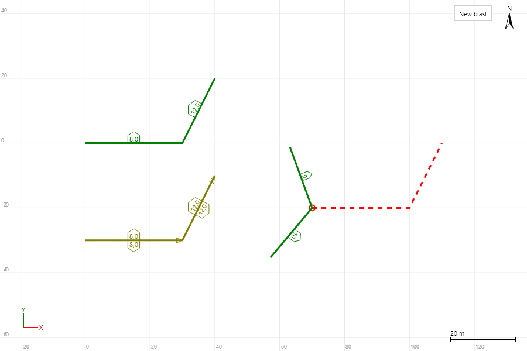

# Фронт отбойки ЭСИ в Blast Designer

Реализация: `src/BlastDesigner.Engine/EbsTimingLine.cs`.

## Инструмент

- До 4 точек (`MAX_POINTS = 4`, т.е. до 3 отрезков); завершение двойным щелчком, Enter или меню.
- На каждый отрезок три значения: скорость горения B (мс/м), замедление R (мс/м), прогрессия P (мс).
- Точка скважины (`EbsTimingLine.TimingPoint`): середина первого срабатывающего заряда (`Charging.FiringChargeMidDepth`), скважина без боевика в заряде — устье (расширенная линия всегда берёт устье). Z отбрасывается.
  Ту же точку берёт «Направление отбойки» (`FirstMovement.Inputs`).

## Фигуры инструмента фронта

Инструмент «Фронт отбойки ЭСИ» строит одну из трёх фигур щелчками, выбора фигуры в панели нет. Первый щелчок ставит начало линии, второй — её конец. Второй щелчок по началу (в радиусе захвата) или Enter после одного начала завершает ввод точкой. Щелчок по концу (в радиусе захвата) или Enter завершает ввод линией; щелчок в другом месте ставит конец второго отрезка и завершает ввод галочкой: вершина — конец первой линии, концы — начало линии и последний щелчок, длины и угол — как щёлкнули. Shift даёт шаг направления 15°, точка ближе `Chevron.MinLength` к предыдущей не ставится. Backspace убирает последнюю точку, Esc отменяет ввод. Пока идёт ввод, кружки и перетаскивание выделенного фронта не действуют. После завершения ввода инструмент переключается на «Выбор», затем открывается окно фронта. У новой галочки с отрезками разной длины замедление второго отрезка задаётся пропорционально длинам (как при перетаскивании конца), чтобы окно не сдвинуло концы. У объекта фигура хранится в `TimingLineEntity.Front`. Файлы, где есть только `isChevron: true`, читаются как галочка. Линия и галочка считаются контурной линией, точка — кругами; окно фронта ни для одной фигуры не предлагает тип линии. Переключатель направления A → B / B → A в окне остаётся: им направление меняют и при правке готового фронта.

- **Линия.** Сохраняется выпрямленной галочкой с вершиной посередине. Скважины на одном расстоянии от линии получают одно время, время растёт с удалением. Сторону роста выбирает `EbsTimingLine.FacingLine`: концы ставятся в таком порядке, чтобы большинство скважин набора (выделенных или всех) лежало слева от направления A → B, а левая сторона контурной линии и есть поздняя. Стрелка от середины линии в предпросмотре показывает эту сторону. Скважины по другую сторону линии получают меньшее время, как и раньше у контурной линии. У выделенной линии кружки на концах двигают конец.
- **Галочка.** Два отрезка с общей вершиной (`Chevron`). Вершина к скважинам не прилипает. Новая галочка создаётся в прямом порядке (A → B, `ReverseOrder = false`): время растёт вдоль луча, от вершины наружу. B → A в окне фронта поворачивает направление. Галочка считается как контурная линия из трёх точек: отрезок выбирается тестом по биссектрисе, время — знаковое расстояние до линии этого отрезка × его замедление, поэтому изохроны параллельны лучам, а на выпуклой стороне скважина получает большее из времён двух лучей. Скважины позади вершины получают меньшее время и участвуют в выборе первой. Для расчёта точки ставятся так, чтобы при A → B слева от обхода (поздней стороной) был луч: если конец перетащили на другую сторону луча, точки и значения отрезков переставляются (`EbsTimingLine.RayLeft`). Тип «две линии» и «линия фронта» у галочки считаются одинаково, скорости горения нет. Овала замедлений нет. Луч от вершины рисуется пунктиром только у выделенной галочки, длиной в сторону галочки; при построении и повороте — на всю ширину вида. У невыделенной галочки луча нет.
- **Точка.** `TimingFrontShape.Point`, хранится одной точкой и одним набором значений (`Segments[0]`: замедление R и прогрессия P), тип — «Точка» (`TimingLineStyle.Point`). Время скважины — расстояние в плане от точки до точки расчёта скважины × R; с прогрессией добавляется `P · (d / 10)^e`, как у контурной линии. Скважины на одной окружности вокруг точки получают одно время, вдвое дальше — вдвое больше. Направление в окне — «От точки» (первой срабатывает ближайшая скважина) и «К точке» (`ReverseOrder`: `t = max − t`, первой самая дальняя). Дальше обычное нормирование: минимум — «Время первой скважины», все скважины в досягаемости. На плане точка рисуется кольцом с крестом в цвете фронта и подписью «R мс/м»; у выделенной точки один кружок, перетаскивание двигает точку. В окне фронта вместо таблицы отрезков — поле «Замедление» (и «Прогрессия», если она включена), скорости горения нет; в панели свойств — «Замедление точки, мс/м». В DXF точка выгружается точкой.
- **Как фигуры переходят друг в друга при перетаскивании кружков.** Конец линии, отпущенный на другом её конце (в радиусе захвата), превращает линию в точку на месте оставшегося конца (`Chevron.Merge`, `TimingLineEntity.PointByPoints`), с замедлением и прогрессией линии. Конец галочки, отпущенный на её вершине, убирает этот отрезок: остаётся линия по другому отрезку с вершиной посередине и его замедлением, обход тот же, поэтому поздняя сторона этого отрезка сохраняется (`Chevron.DropSegment`). Совмещённые концы галочки (конец на другом конце) по-прежнему не допускаются: такой конец стоит на месте, как и конец, лежащий вдоль другого отрезка. Из точки обратно в линию — через тип в панели свойств (ниже) или отменой.
- **Тип в панели свойств.** У фронта инструмента «Тип линии времени» — по одному типу на фигуру: «Линия фронта» (прямая), «Два фронта» (галочка), «Точка»; список у любой фигуры показывает все три (`TimingLineEntity.AllowedStyles`). Выбор другого типа меняет фигуру (`TimingLineEntity.ShapeByType`) и программирует скважины фронта заново, одним шагом отмены; время первой скважины, прогрессия, порядок, слой, цвет и назначенные скважины остаются. Линия → галочка — изгиб до 170° с концами на месте, галочка → линия — выпрямление с вершиной посередине (как раньше). Линия или галочка → точка — точка в вершине (у линии это середина), с замедлением и прогрессией первого отрезка. Точка → линия — прямая через точку, отрезки по `TimingLineEntity.FromPointLength` = 10 м, поздней стороной к середине скважин фронта (без скважин — на север). Точка → галочка — `Chevron.Build` с вершиной в точке, углом `Chevron.DefaultAngleDeg` (90°), лучами по 10 м и лучом к середине скважин. У обоих отрезков — замедление точки. «Расширенная линия» фронтам не предлагается: это тип линий, поставленных по точкам (до инструмента фронта), у них список прежний, без «Точки». Служебное поле «Has handles» в панели не показывается.

Обозначения: для отрезка k — единичное направление `s_k`, правая нормаль `n_k = s_k × Z`, длина `L_k`; для скважины `h = P − c_k`.

## Прогрессия

Показатель e по индексу 0…4: 1.1, 1.2, 1.4, 1.6, 2.0. Добавка `prog(d) = P · (|d| / 10)^e`, то есть P — добавка в мс на расстоянии 10 м.

## Контурная линия (EBS_TimeLine)

1. Выбор отрезка по биссектрисам: `TN0 = n0·R0 − n1·R1` (знак так, чтобы смотреть вдоль c1−c0), `TN1 = n1·R1 − n2·R2`, `TN2 = n0·R0 − n2·R2`; точки теста c1, c2 и точка пересечения перпендикуляров к TN0 через c1 и к TN1 через c2.
   - 2 точки → отрезок 0; 3 точки → `TR0 ? 1 : 0`; 4 точки → `TR0 && !TR1 ? 1 : (TR0 || TR2 ? 2 : 0)`, где `TRi = (P − Ti)·TNi > 0`.
2. `d = h·n_k`; `t = −d · R_k`; если `d < 0` и включена прогрессия: `t += prog(d)`.

## Линия горения (EBS_BurnLine)

Для каждого отрезка, где проекция `a = h·s_k` лежит в `[0, L_k]` (у первого отрезка — без нижней границы, у последнего — без верхней):
`t_k = |h·n_k| · R_k + prog(|h·n_k|) + a · B_k + Σ_{j<k} L_j · B_j`; берётся минимум.
Если ни один отрезок не подошёл (точка снаружи излома), берётся максимум из двух соседних отрезков у излома (второй — с длиной `a_{k+1} + L_k` и скоростью B_k).

## Расширенная линия (EBS_AdvBurn)

Одно замедление BR вдоль линии; сбоку `BR·tan(Angle1)` слева и `BR·tan(Angle2)` справа:
`t = |отступ| · BR·tan(угол стороны) + (расстояние вдоль линии от первой точки) · BR`. У изломов отрезок выбирается по биссектрисе.

## Нормирование и ограничения

- Фронт программирует только скважины с ЭСИ (`Charging.HasElectronicDetonator`). Остальные он пропускает и считает в
  `TimingLineResult.NotElectronic`; это число видно в строке статуса и в итоге окна. Скважина с НСИ взрывается по коммутации:
  если фронт задал ей время раньше (до 0.3.1), это время сбрасывается при открытии файла, кроме ручного.
  В `HoleIds` линии попадают только скважины с ЭСИ.
- Сырые времена сдвигаются так, чтобы самая ранняя скважина (ручные тоже участвуют) получила «Время первой скважины».
- Скважина вне досягаемости линии (нет времени линии горения) остаётся без времени: `Apply` ставит ей `ElectronicTimeMs = null`, ручные не трогает, номера перечисляются в итоговом сообщении.
- Скважина, у которой время вместе с последним её боевиком (`Charging.MaxPrimerOffset`) больше максимального замедления ЭСИ,
  не программируется и попадает в итоговое сообщение; у скважины со смещением боевика оно указано.
- Скважина принадлежит одному объекту времени (фронту или точке открытия): объект, который берёт скважины, убирает их из
  `HoleIds` остальных (`IHoleTimer`).
- Фронт следит за своими скважинами: после любого изменения проекта (`Document.Execute` → `Document.Followers` →
  `EbsTimingLine.Follow`) каждый фронт, у которого поменялась точка скважины или наличие ЭСИ (координаты, зарядка, боевики),
  программирует свои скважины заново в том же шаге отмены. Ручные времена не меняются.
- Скважины с временем, заданным вручную, по умолчанию не перезаписываются. Если такие скважины есть среди скважин фронта, окно
  показывает надпись «Есть скважины с ручным временем» и флажок «Применить к скважинам с ручным временем»
  (`TimingLineOptions.KeepManualTimes`); флажок не запоминается после применения.
- Время округляется до 1 мс, а при `Electronic.AllowSubMs` (флажок «Доли миллисекунды» в настройках ЭСИ) — до 0,1 мс.
  Округление одно — `Timing.RoundTime`: его вызывают `Timing.SetTime` и предпросмотр фронта. В файлах до 0.3.1 был шаг
  `TimeStepMs`; шаг меньше 1 мс читается как `AllowSubMs = true`.

## Боевики

Модель: `Deck.Primers` → `Primer { Depth, BoosterId, DetonatorId, DelayMs?, OffsetMs }`.

- **Смещение ЭСИ** (`Primer.OffsetMs`, мс, по умолчанию 0) — время боевика после времени скважины. В окне зарядки у боевика с
  детонатором вида «Электронный» вместо поля «Замедление» поле «Смещение от времени скважины, мс». Хранится в файле и в правилах.
- **Настройки ЭСИ** (`ElectronicSettings`, раздел «Секции и боевики»): `InterDeckDelayMs` «Между секциями»,
  `IntraDeckDelayMs` «Замедление в секции», `DeckOrder` «Взрыв секций» (Низ-Верх, Верх-Низ, одновременно), `PrimerOrder`
  «Порядок боевиков в секции», `UseOffsets` «Использовать смещения». По умолчанию все задержки 0: старые файлы считаются как раньше.
- **Времена боевиков** — `Charging.PrimerTimes(project, hole, holeTime)` по `HoleLoading.SetEBSTimes`:
  - при `UseOffsets` боевик ЭСИ получает `holeTime + OffsetMs`, не меньше 0;
  - иначе заряды (`Charging.ExplosiveRuns`: смежные взрывчатые секции без инертных и без промежутков между ними) с боевиком ЭСИ
    идут в порядке `DeckOrder`. Первый получает `holeTime`, каждый следующий ещё `+InterDeckDelayMs` (одновременно — все
    `holeTime`). Боевики ЭСИ одного заряда идут в порядке `PrimerOrder` через `IntraDeckDelayMs`.
  - Время скважины уже округлено; добавка к нему округляется вместе с ним (`Timing.RoundTime`).
- **Заряды** (`Hole.Charges`, считает `Timing.Solve`, как `BaseHole.CalcInholeTiming`): у заряда глубины верха и низа, середина
  и время самого раннего боевика в нём. Боевик ЭСИ: `BaseTimeMs + PrimerTimes`. Боевик НСИ: поверхностное время + замедление
  детонатора + прохождение сигнала по волноводу (`Depth · Product.PropagationMsPerM`, только у скважинного детонатора НСИ,
  поле «Прохождение сигнала по волноводу» в справочнике, по умолчанию 0). `FiringTimeMs` скважины — самый ранний заряд;
  `InholeDelayMs` остаётся для подписей. Скважина без зарядов с временем считается по-старому.
- **События по зарядам** (`Charging.ChargeEvents`): огибающая по времени, график заряда во времени, сейсмика и МВЗ берут каждый
  заряд отдельно. Масса заряда — масса его секций и боевиков; вместе они дают массу скважины по профилю расчётов.
- **Экспорт BPD** (`DeviTronic.Build`): каждый детонатор получает время своего боевика из `PrimerTimes`.
- **Правила зарядки**: `DeckTemplate.Primers` — список `PrimerTemplate { Offset?, BoosterId, DetonatorId, DelayMs?, OffsetMs }`.
  `Offset` — высота над низом секции; пустой — равномерно вверх по секции от первого (как прежний `PrimerCount`).
  Старые поля `PrimerCount`, `PrimerOffset(s)`, `BoosterId`, `DetonatorId` читаются как список одинаковых боевиков и больше
  не пишутся; окно правил редактирует их поверх списка. `RuleFromColumn` сохраняет каждый боевик колонки, `ApplyRule` ставит их.
- **Davey Tronic** (`Id 5f2d6f31-4a02-4514-a200-0a6d6490db5a`, семейство «Davey Tronic»; до 0.3.7 — «DeviTronic», старые проекты переименовываются при открытии) — электронный детонатор встроенного
  справочника; `ProductCatalogue.Attach` добавляет его и в проекты из старых файлов.

## Точка открытия EBS

`EbsOpeningPoint` (Domain), расчёт — `EbsOpening` (Engine). Кнопка «Точка открытия» на этапе
«Инициирование»: щелчок ставит точку, окно задаёт ЛНС и РМС (по умолчанию из проекта), азимут ЛНС, замедления по ЛНС и РМС
(по умолчанию интервалы рядов и скважин ЭСИ), время первой скважины и флажок «Открыть сегмент в этой точке».

- d — вектор от опорной точки до `TimingPoint` скважины, b̂ — направление ЛНС по азимуту, ŝ — ЛНС, повёрнутая на 90° по часовой:
  `t = (d·b̂)/ЛНС·ΔtЛНС + (d·ŝ)/РМС·ΔtРМС`.
- С флажком «Открыть здесь» оба слагаемых по модулю, а опорой становится скважина с наименьшим таким временем: V-схема.
- Затем сдвиг на время первой скважины; предел, сброс, ручные времена, только ЭСИ и пересчёт при изменении скважин — как у фронта.
  Точка пересчитывает свои скважины и при изменении своих значений.
- Окно показывает «Общий рельеф» = √((ΔtРМС/РМС)² + (ΔtЛНС/ЛНС)²), мс/м.
- На плане — четырёхконечная звезда и два луча, по ЛНС и по РМС, длиной в своё расстояние, с подписями вида «42ms / 4 m».

## Разгрузка ЛНС

`BurdenRelief` (Engine) по `TimingDelaunay` из `FirstMovement.cs` (`EVIETimingDelaunay.SetupZvalues`): в каждом треугольнике
точек срабатывания |∇t|, мс/м; треугольники у супертреугольника и слишком узкие отбрасываются. `BurdenReliefOverlay` заливает
треугольники пятью цветами от синего к красному, от наименьшей разгрузки до наибольшей или до «Верхнего предела» (больше
предела — красный), с легендой. Окно «Разгрузка ЛНС» (команда «Разгрузка ЛНС») — поле «Верхний предел», легенда, значение под
курсором; та же заливка на основном плане, пока окно открыто. Раздел отчёта «Разгрузка ЛНС» — план с заливкой и легендой.

## Отрисовка

`TimingLineEntity` (`src/BlastDesigner.Domain/Model/TimingLine.cs`) и `PlanRenderer.DrawTimingLine`.

- После завершения линия остаётся в проекте объектом (слой «Фронты отбойки ЭСИ»), сохраняется в файле и выделяется как обычный объект.
- Контурная линия: зелёная (`Color.Green`), толщина 3. Посередине каждого отрезка П-образная скобка с числом — замедление отрезка, мс/м (формат `f1`). Скобка стоит на стороне `−n` экрана: туда растёт время.
- Линия горения: оливковая (`Color.Olive`). Скобка с числом с обеих сторон и треугольная стрелка в конце каждого отрезка (направление горения). При «обратном направлении» линия рисуется от последней точки.
- Расширенная линия: красный пунктир, красный кружок радиусом 5 px в первой точке, два луча по 20 м под углами фронтов (`90° + Angle1` против часовой — левый, `−(90° + Angle2)` — правый). На лучах число `BR / cos(угол)` (формат `f0`).
- Скобки, числа и стрелки строятся в экранных координатах (2D-слой поверх вида), поэтому их размер не зависит от масштаба. Привязка — середина отрезка в мировых координатах, текст повёрнут вдоль отрезка на экране.

## Высота (Z)

- У линии нет своей высоты: каждая точка хранит Z, полученную при щелчке, и линия рисуется по этим Z.
- Blast Designer: при привязке — Z точки привязки, иначе плоскость на средней отметке устьев (без скважин — цель камеры).
- В расчёте времени Z не участвует.
