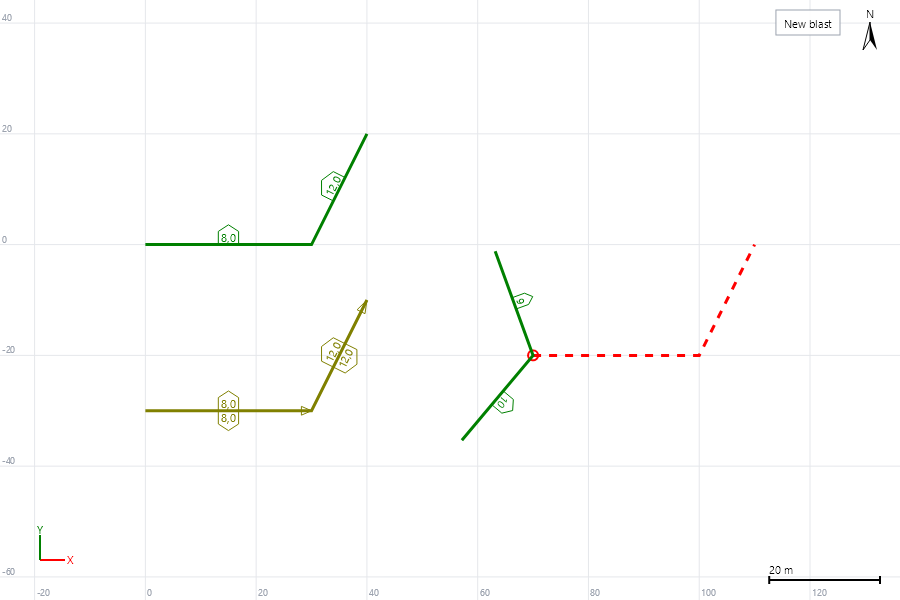

# Линия времени ЭСИ в Blast Designer

Реализация: `src/BlastDesigner.Engine/EbsTimingLine.cs`.

## Инструмент

- До 4 точек (`MAX_POINTS = 4`, т.е. до 3 отрезков); завершение двойным щелчком, Enter или меню.
- На каждый отрезок три значения: скорость горения B (мс/м), замедление R (мс/м), прогрессия P (мс).
- Точка скважины: положение первого срабатывающего боевика, иначе устье (расширенная линия всегда берёт устье). Z отбрасывается.

Обозначения: для отрезка k — единичное направление `s_k`, правая нормаль `n_k = s_k × Z`, длина `L_k`; для скважины `h = P − c_k`.

## Прогрессия

Показатель e по индексу 0…4: 1.1, 1.2, 1.4, 1.6, 2.0. Добавка `prog(d) = P · (|d| / 10)^e`, то есть P — добавка в мс на расстоянии 10 м.

## Контурная линия (EBS_TimeLine)

1. Выбор отрезка по биссектрисам: `TN0 = n0·R0 − n1·R1` (знак так, чтобы смотреть вдоль c1−c0), `TN1 = n1·R1 − n2·R2`, `TN2 = n0·R0 − n2·R2`; точки теста c1, c2 и точка пересечения перпендикуляров к TN0 через c1 и к TN1 через c2.
   - 2 точки → отрезок 0; 3 точки → `TR0 ? 1 : 0`; 4 точки → `TR0 && !TR1 ? 1 : (TR0 || TR2 ? 2 : 0)`, где `TRi = (P − Ti)·TNi > 0`.
2. `d = h·n_k`; `t = −d · R_k`; если `d < 0` и включена прогрессия: `t += prog(d)`.

## Линия горения (EBS_BurnLine)

Для каждого отрезка, где проекция `a = h·s_k` лежит в `[0, L_k]` (у первого отрезка — без нижней границы, у последнего — без верхней):
`t_k = |h·n_k| · R_k + prog(|h·n_k|) + a · B_k + Σ_{j<k} L_j · B_j`; берётся минимум.
Если ни один отрезок не подошёл (точка снаружи излома), берётся максимум из двух соседних отрезков у излома (второй — с длиной `a_{k+1} + L_k` и скоростью B_k, как в оригинале).

## Расширенная линия (EBS_AdvBurn)

Одно замедление BR вдоль линии; сбоку `BR·tan(Angle1)` слева и `BR·tan(Angle2)` справа:
`t = |отступ| · BR·tan(угол стороны) + (расстояние вдоль линии от первой точки) · BR`. У изломов отрезок выбирается по биссектрисе.

## Нормирование и ограничения

- Сырые времена сдвигаются так, чтобы самая ранняя скважина (ручные тоже участвуют) получила «Время первой скважины».
- Скважина, у которой время больше максимального замедления ЭСИ, не программируется и попадает в отчёт.
- Скважины с временем, заданным вручную, не перезаписываются (в оригинале об этом спрашивается; в Blast Designer — всегда «нет»).

## Отрисовка

Источник: `SPEBSTimingLineViewObj.Draw`. Порт: `TimingLineEntity` (`src/BlastDesigner.Domain/Model/TimingLine.cs`) и `PlanRenderer.DrawTimingLine`.

- После завершения линия остаётся в проекте объектом (в оригинале — слой 9, в Blast Designer — слой «Линии времени»), сохраняется в файле и выделяется как обычный объект.
- Контурная линия: зелёная (`Color.Green`), толщина 3. Посередине каждого отрезка П-образная скобка с числом — замедление отрезка, мс/м (формат `f1`). Скобка стоит на стороне `−n` экрана: туда растёт время.
- Линия горения: оливковая (`Color.Olive`). Скобка с числом с обеих сторон и треугольная стрелка в конце каждого отрезка (направление горения). При «обратном направлении» линия рисуется от последней точки.
- Расширенная линия: красный пунктир, красный кружок радиусом 5 px в первой точке, два луча по 20 м под углами фронтов (`90° + Angle1` против часовой — левый, `−(90° + Angle2)` — правый). На лучах число `BR / cos(угол)` (формат `f0`).
- Скобки, числа и стрелки строятся в экранных координатах (2D-слой поверх вида), поэтому их размер не зависит от масштаба. Привязка — середина отрезка в мировых координатах, текст повёрнут вдоль отрезка на экране.

## Высота (Z)

- У линии нет своей высоты: каждая точка хранит Z, полученную при щелчке, и линия рисуется по этим Z.
- Оригинал: `ScreenToWorld` проецирует курсор на плоскость через опорную точку мыши перпендикулярно взгляду. Опорная точка — последняя точка привязки в любом инструменте (`SnapToTarget` → `SetMouseRefPoint`), обычно устье скважины; до первой привязки — начало координат вида (точка первого видимого объекта). При привязке к скважине точка получает её координату.
- Blast Designer: при привязке — Z точки привязки, иначе плоскость на средней отметке устьев (без скважин — цель камеры).
- В расчёте времени Z не участвует.

## Отличия порта

- Линия программирует выбранные (или все) скважины в момент создания; в оригинале она ещё и пересчитывается автоматически по полигонам материала и горизонтам.
- Предел — `Electronic.MaxTimeMs` проекта (в оригинале — предел модели бластера плюс смещение боевика в скважине).
- Время округляется до шага `Electronic.TimeStepMs`.
