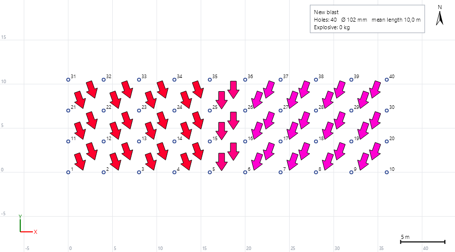

# First Movement (направление отбойки) в Blast Designer

Реализация: `src/BlastDesigner.Engine/FirstMovement.cs` (`TimingDelaunay`, `FirstMovement`), `FirstMovementOverlay` в `src/BlastDesigner.Rendering/Overlays.cs`, окно `AnalysisWindows.FirstMovementWindow`.

## Расчёт

1. Точки: для каждой скважины с временем — середина заряда с первым срабатывающим боевиком, время срабатывания.
2. Триангуляция Делоне в плане, порядок вставки — порядок скважин: супертреугольник `(cx, cy+1.4s)`, `(cx−1.6s, cy−0.7s)`, `(cx+1.6s, cy−0.7s)`, где `s = max(Δx, Δy) + 1`; поиск треугольника обходом, флипы Лоусона; дубликаты (|Δx|, |Δy| < 0.001) не соединяются.
3. Изменённый тест окружности: если обе пары углов почти прямые (|cos| < 1e-4), диагональ соединяет вершины с меньшей разницей **отметок Z**.
4. Плоскость времени на треугольнике: `a = det|y t 1|`, `b = −det|x t 1|`, `c = det|x y 1|`, нормировка до единичной; `slope = |√(1−c²)/c|` = |∇t|, мс/м.
5. Треугольник годен, если площадь > 0.05·(длина самой длинной стороны)². Треугольник с `c = 0` негоден.
6. Стрелка: в центре годного внутреннего треугольника, направление `(a, b)/|(a, b)|`; при `|(a, b)| < 0.01` стрелки нет. Треугольники идут против часовой стрелки, поэтому `c > 0` и стрелка смотрит по −∇t — к скважинам, взорванным раньше, перпендикулярно изохронам.

## Отрисовка

- Размер стрелки — 2 м (кнопки ±0.2 м, от 0.2 до 10), масштабируется с видом.
- Форма: по умолчанию 7-угольная стрелка; в окне можно выбрать «Треугольники» или «Авто» — маленький треугольник от `−d` до `+d` (полуширина основания `0.7·|d|`), а стрелка только если стрелки покрывают меньше 30 % площади триангуляции.
- Заливка — HSV(угол направления на экране, 1, 1), обводка чёрная. Отрицательные углы дают красно-фиолетовые оттенки.
- Стрелки обрезаются по замкнутым границам взрыва.

