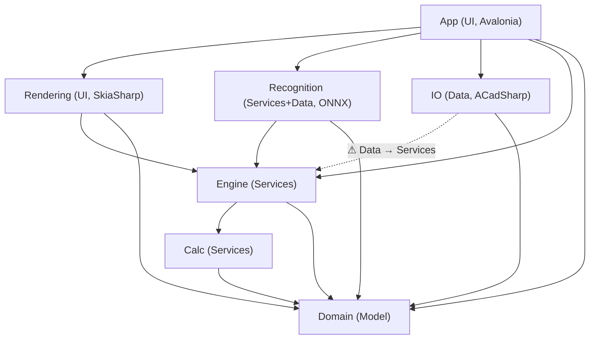

# Blast Designer: соответствие трёхслойной архитектуре

*Дата анализа: 2026-11-13, ветка `dev_visual` (с незакоммиченными изменениями рабочей копии). Анализ только для чтения, код не менялся.*

Целевая модель:

| Слой | Что в нём должно быть |
|---|---|
| **1. UI** | окна, панели, диалоги, контролы, view model, вывод на экран |
| **2. Services** | бизнес-логика и классы модели/домена |
| **3. Data access** | чтение/запись файлов, БД, сети, реестра; встроенные ресурсы (json, xml, html, tsv, onnx…) |

Направление зависимостей: UI → Services → Data (Data знает только модель домена).

---

## 1. Итог

Решение в целом **хорошо разделено на уровне проектов**: из 7 проектов только `BlastDesigner.App` ссылается на UI-фреймворк (Avalonia). В `Domain`, `Calc`, `Engine`, `IO`, `Rendering` и `Recognition` нет ни одного `using Avalonia`, `System.Windows`, `MessageBox` или `Dispatcher`. Циклов в графе нет. Главные отклонения от целевой модели другие. (1) Слой данных `BlastDesigner.IO` ссылается на слой сервисов `Engine` и выполняет бизнес-расчёты прямо при экспорте: вызывает `Timing.Solve`, `Charging.ExplosiveMass`, `HoleDesign.CreateHole`. (2) UI-проект напрямую работает с файлами, реестром и встроенными ресурсами: 17 из 70 файлов, около 45 вызовов. (3) Сервисы `Calc`, `Engine` и `Recognition` сами читают файлы и встроенные ресурсы: `CalcProfile.Save/Load`, `Formulas.bdcalc`, `survey-segments.onnx`. (4) Между слоями нет интерфейсов и DI: почти вся логика лежит в статических классах (85 из 503 типов), а глобальные статические настройки (`Charging.MinStemmingDiameters`, `CalcService.RussianNames`, `PlanRenderer.Translate`, `SizeUnits.Default`, `BlockLayers.BaseName`) UI выставляет в нижних слоях. Оценка соответствия: **примерно 70 %**. Деление на проекты правильное, а утечки идут в основном «вниз» (UI делает IO) и «вбок» (IO делает расчёты). Опасных утечек «вверх» (домен знает UI) нет.

---

## 2. Проекты и зависимости

| Проект | Слой (назначенный) | .cs файлов / строк | ProjectReference | PackageReference | Встроенные ресурсы |
|---|---|---|---|---|---|
| `BlastDesigner.App` | **1 UI** | 70 / 26 613 | Domain, Engine, IO, Rendering, Recognition | Avalonia 11.3.13 (+Desktop, Fluent, Fonts.Inter, DataGrid, ColorPicker, Diagnostics), CommunityToolkit.Mvvm 8.2.2, Tmds.DBus.Protocol, System.Drawing.Common 10.0 | `Services/ru.tsv` (Embedded), `Assets/icons/app-icon.ico` (AvaloniaResource) |
| `BlastDesigner.Rendering` | **1 UI** (вывод на экран/в PDF; SkiaSharp без UI-фреймворка) | 8 / 4 162 | Domain, Engine | SkiaSharp 2.88.9 | — |
| `BlastDesigner.Engine` | **2 Services** | 26 / 7 057 | Calc, Domain | — | `Calc/Formulas.bdcalc` |
| `BlastDesigner.Calc` | **2 Services** (движок формул) | 13 / 3 325 | Domain | — | — |
| `BlastDesigner.Domain` | **2 Services (модель)** | 19 / 3 892 | — | — (System.Text.Json из BCL) | — |
| `BlastDesigner.Recognition` | **2 Services + 3 Data** (смешанный) | 1 / 101 | Domain, Engine | Microsoft.ML.OnnxRuntime 1.31.1 | `ml/models/survey-segments.onnx` |
| `BlastDesigner.IO` | **3 Data** | 15 / 2 782 | Domain, **Engine** | ACadSharp 3.8.0 | `CHANGELOG.md`, `CHANGELOG.en.md` |

Тесты: `tests/BlastDesigner.Tests` и `tests/BlastDesigner.UiSmoke` ссылаются на все 7 проектов.

### Граф зависимостей



ASCII-вариант:

```
              App (UI)
   ┌─────┬──────┼────────┬──────────┐
   ▼     ▼      ▼        ▼          ▼
Rendering Recognition  IO(Data)   Engine ──► Calc ──► Domain
   │     │         ⚠────┘ (IO→Engine)  │                ▲
   └─────┴────────────► Engine ───────┴────────────────┘
```

**Ссылки в неправильную сторону:**

| Ссылка | Почему неправильно | Как используется |
|---|---|---|
| `IO → Engine` | слой данных зависит от слоя бизнес-логики | `Charging.*` в `DeviTronic.cs`, `TextFiles.cs`, `Interchange.cs`, `ProjectFile.cs`; `Timing.Solve` в `Interchange.cs:335`, `TextFiles.cs:264`; `HoleDesign.*` в `Interchange.cs:251`, `TextFiles.cs:192`; `CalcService.Value` в `TextFiles.cs:209` |
| `Recognition → Engine` | формально Services → Services, но проект совмещает загрузку ресурса (Data) и вызов логики Engine | `SurveyFeatures`, `SurveyRecognizer` |
| UI-фреймворк в Services/Data | **нет** | — |
| Циклы | **нет** | — |

Отдельно стоит пакет `System.Drawing.Common` в App, он используется только в `Services/Printing.cs` для печати на Windows. Это UI/платформенный код, по слою он на месте.

---

## 3. Распределение классов по слоям

### 3.1 BlastDesigner.App (70 файлов)

| Папка | Файлов | Слой | Комментарий |
|---|---|---|---|
| `Views/` | 31 | UI | окна и панели собраны кодом (без XAML, кроме `App.axaml`). Внутри есть IO и куски расчётов (см. §4) |
| `ViewModels/` | 9 (partial `MainViewModel`) | UI | `ObservableObject` из CommunityToolkit.Mvvm. По сути один «God VM» на 4 579 строк (`MainViewModel.Tools.cs`, 1 392 строки). Содержит файловый IO и оркестрацию сценариев |
| `Tools/` | 15 | UI | инструменты мыши (выбор, лассо, ручки, рисование). Геометрия в основном вызывается из `Domain.Geometry`, но в `FrontLineTool.cs` 18 мест с собственной тригонометрией |
| `Controls/` | 3 | UI | `Viewport`, `CameraPad`, `ViewCubeControl` |
| `Services/` | 10 | смешанный | UI: `Dialogs`, `Look`, `Icons`, `DarkStart`, `GraphicsAdapter`, `NumberStep`, `Printing`. **Data**: `Loc.Ru.cs` (чтение `ru.tsv`). **Services+Data**: `Trial.cs` (лицензионная логика, реестр, файлы, MachineGuid). `Loc.cs` — локализация, глобальное состояние |
| корень | 2 | UI | `App.axaml.cs`, `Program.cs` (внутри есть self-test с файловым IO) |

Итого в App: около **63 файлов UI**, **2 файла Data** (`Loc.Ru.cs`, часть `Trial.cs`), **около 1 файла Services** (`Trial.cs`). Ещё **17 файлов** содержат прямые IO-вызовы.

### 3.2 BlastDesigner.Rendering (8 файлов) — UI (отрисовка)

| Класс | Слой | Комментарий |
|---|---|---|
| `PlanRenderer` (1 965 строк), `Overlays`, `Camera`, `DepthMap`, `TextBatch`, `ViewCube` | UI | отрисовка плана в SkiaSharp |
| `Reports` | UI + Services | собирает содержимое отчёта (`Quantities.Compute`, `Timing.Solve` в строках 39 и 204: **меняет проект**) |
| `ReportDocument` | UI + Data | хранит страницы и пишет PDF в `Stream` |

### 3.3 BlastDesigner.Engine (26 файлов) — Services

Все классы относятся к бизнес-логике: `Charging`, `Timing`, `EbsTimingLine`, `HoleDesign(.Patterns)`, `Surfaces`, `Quantities`, `Prediction`, `Analysis`, `FirstMovement`, `SurveyFeatures/Recognizer/Synth`, `DesignRules` (Initiation/Tolerance/Strata) и другие. 22 из 26 файлов — статические классы.
Исключения: `Calc/CalcService.cs` загружает встроенный `Formulas.bdcalc` (функция Data) и держит глобальную библиотеку профилей. `FirstMovement.ColorFromHsv` (`FirstMovement.cs:308`) — функция представления (цвет) в сервисе. Тип UI-фреймворка при этом не используется.

### 3.4 BlastDesigner.Calc (13 файлов) — Services

Компилятор и интерпретатор формул: `Syntax`, `Compiler`, `CalcModel`, `CalcSession`, `CalcScope`, `Registry`, `Units`… Исключение `CalcProfile.cs`: в нём `File.WriteAllText`/`ReadAllText` и сканирование папки (`Directory.EnumerateFiles`).

### 3.5 BlastDesigner.Domain (19 файлов) — Services (модель)

`Model/` (12): `BlastProject`, `Hole`, `Block`, `Entities`, `Products`, `Catalogue`, `TimingLine`, `ReportDesign`… `Geometry/` (4): `Vec3`, `GeoMath`, `Chevron`, `Lasso`. Корень: `Document` (undo/выделение), `NaturalOrder`, `ProjectJson`.
`ProjectJson` (сериализация в JSON) по смыслу относится к Data, но работает только с `byte[]`/`string`, без файлов. Это допустимый компромисс.

### 3.6 BlastDesigner.IO (15 файлов) — Data

| Класс | Слой фактически |
|---|---|
| `ProjectFile`, `CadFiles`, `SurveyDxf`, `TextFiles`, `Interchange`, `DeviTronic`, `ReportDesignFile`, `UserCatalogue`, `FragmentationPreset`, `Changelog`, `UsageLog` | Data (но см. нарушения: `TextFiles`, `Interchange`, `DeviTronic`, `ProjectFile` содержат бизнес-правила) |
| `ProgramSettings` | Data + модель настроек; в том же файле статические `SafeFile` и `Log` |
| `UsageAnalysis` | **Services** (аналитика журнала использования) |
| `Utm` | **Services** (геодезическая математика) |
| `SurveyLabels` | Services/Data (разбор подписей с вызовами Engine) |

### 3.7 BlastDesigner.Recognition (1 файл)

`SurveyModel`: загрузка ONNX из ресурсов (Data) плюс инференс и классификация (Services) в одном статическом классе с `Lazy`-синглтоном.

### 3.8 Сводка по слоям (файлы .cs, всего 152)

| Слой | Файлов «чисто» | Файлов смешанных | Проекты |
|---|---|---|---|
| UI | 69 (App 63 + Rendering 6) | 11 (App Services/VM/Views с IO, Rendering `Reports`/`ReportDocument`) | App, Rendering |
| Services (+ модель) | 55 (Engine 25, Calc 12, Domain 18) | 6 (`CalcService`, `CalcProfile`, `ProjectJson`, `SurveyModel`, `UsageAnalysis`, `Utm`) | Engine, Calc, Domain, (Recognition) |
| Data | 10 (IO) | 5 (`TextFiles`, `Interchange`, `DeviTronic`, `ProjectFile`, `SurveyLabels`) | IO, (Recognition) |

*Смешанные файлы учтены один раз, по основному слою проекта; суммы приблизительные.*

---

## 4. Нарушения слоёв

Сводка по типам:

| Тип нарушения | Кол-во мест | Файлов |
|---|---|---|
| A. Ссылка проекта в неправильную сторону (`IO → Engine`) | 1 ссылка, около 15 вызовов | 6 |
| B. Бизнес-логика в слое данных | 7 | 5 |
| C. Прямой файловый IO, реестр, ресурсы в UI | около 45 вызовов | 17 |
| D. Бизнес-логика или расчёты в UI | 8 (существенных) | 6 |
| E. IO или загрузка ресурсов в сервисах | 4 | 4 |
| F. Глобальное статическое состояние, пересекающее слои | 7 статических свойств нижних слоёв выставляются из UI; около 60 статических полей всего | 12 |
| G. Нет интерфейсов и DI между слоями | 6 интерфейсов на 503 типа, ни одного на границе слоёв | — |
| H. UI-типы в сервисах/домене | **0** | 0 |
| I. Дубли моделей (кратко) | 2 | 4 |

### 4.1 Высокая серьёзность

| Файл:строка | Тип | Что не так | Куда перенести |
|---|---|---|---|
| `src/BlastDesigner.IO/BlastDesigner.IO.csproj` (ProjectReference Engine) | A | Data зависит от Services, поэтому слой данных нельзя заменить или протестировать без бизнес-логики | убрать ссылку. Экспорт получает уже посчитанные значения (DTO) от сервиса |
| `src/BlastDesigner.IO/Interchange.cs:335` | B | `Timing.Solve(project)` при экспорте **меняет модель** внутри слоя данных | сервис экспорта (`ExportService`) решает времена, IO только пишет |
| `src/BlastDesigner.IO/TextFiles.cs:264` | B | то же: `Timing.Solve` в экспорте | то же |
| `src/BlastDesigner.IO/TextFiles.cs:209` | B | `CalcService.Value(project, propertyId, h)`: расчёт формул в экспорте | сервис формирует строки отчёта, IO форматирует CSV |
| `src/BlastDesigner.IO/TextFiles.cs:192` | B | `HoleDesign.SetLengthToGrade` при импорте: правило проектирования внутри парсера | парсер возвращает сырые записи, сервис импорта применяет правила |
| `src/BlastDesigner.IO/Interchange.cs:251` | B | `HoleDesign.CreateHole(...)` в импорте | так же: сервис импорта |
| `src/BlastDesigner.IO/DeviTronic.cs:228-249` | B | `Charging.PrimerTimes/Primers/HasElectronicDetonator`: расчёт времён и состава заряда при экспорте в DeviTronic | сервис готовит модель экспорта |
| `src/BlastDesigner.IO/ProjectFile.cs:95-108` | B | миграция схемы содержит бизнес-правило (`Charging.HasElectronicDetonator`, `InitiationLinks.Normalize`, `ProductCatalogue.Attach`) | разделить: IO читает JSON и версию, `ProjectMigration` в Services применяет правила |
| `src/BlastDesigner.Rendering/Reports.cs:39`, `:204` | B/D | отрисовка отчёта вызывает `Timing.Solve` и меняет модель | отчёт получает уже решённый проект (вызов в сервисе или VM) |
| `src/BlastDesigner.App/Services/Trial.cs:199-259` | C+D | логика пробного периода, чтение реестра (`HKLM\...\Cryptography`, `HKCU`), файлы `state.bin` и `.bdcache`: UI + Services + Data в одном классе | `TrialService` (Services) + `ITrialStore` (реализации Registry и File в Data) |

### 4.2 Средняя серьёзность

| Файл:строка | Тип | Что не так | Куда перенести |
|---|---|---|---|
| `src/BlastDesigner.App/ViewModels/MainViewModel.File.cs:271` | C | `File.ReadAllLinesAsync` в VM перед импортом текста | `TextFiles.ImportFile(path, fmt, …)` в IO |
| `src/BlastDesigner.App/ViewModels/MainViewModel.File.cs:377` | C | `File.WriteAllTextAsync` (общий метод `ExportText`) | `IExportWriter`/`TextFiles.Write` в IO |
| `src/BlastDesigner.App/ViewModels/MainViewModel.File.cs:418` | C | `File.Create` + `report.WritePdf` | `ReportFile.SavePdf(path, report)` в IO |
| `src/BlastDesigner.App/ViewModels/MainViewModel.File.cs:89` | C | `File.Open` для проверки блокировки файла | `ProjectFile.IsLocked(path)` |
| `src/BlastDesigner.App/ViewModels/MainViewModel.File.cs:431-433` | C | `Process.Start` открывает файл в ОС | `IShellService` (платформенный сервис UI) |
| `src/BlastDesigner.App/ViewModels/MainViewModel.Version6.cs:373` | C | чтение MWD-файла в VM | `Interchange.ImportMwdFile(path, …)` |
| `src/BlastDesigner.App/ViewModels/MainViewModel.Edit.cs:75-76` | C | запись PNG во временный файл | IO-хелпер |
| `src/BlastDesigner.App/Views/AnalysisWindows.cs:504-508` | C+D | чтение и **разбор** CSV виброграммы прямо в окне | `VibrationTraceFile.Load` (IO) → модель `VibrationTrace` (Domain) |
| `src/BlastDesigner.App/Views/AnalysisWindows.cs:497` | D | расчёт пиков (`Max(Abs)`) в окне | `Analysis.Peaks` в Engine |
| `src/BlastDesigner.App/Views/AnalysisWindows.cs:796` | C | `File.WriteAllText` CSV стрелок первого движения | IO |
| `src/BlastDesigner.App/Views/AnalysisWindows.cs:1138-1151` | C | чтение и запись вложений (`ReadAllBytes`, `WriteAllBytesAsync`) | `AttachmentStore` в IO |
| `src/BlastDesigner.App/Views/AnalysisWindowsNew.cs:467-473` | C+D | чтение и разбор CSV событий вибрации в окне | `VibrationRecordsFile.Load` в IO |
| `src/BlastDesigner.App/Views/CalcEditorWindow.cs:1229-1234` | C | путь к папке, `Directory.CreateDirectory`, сохранение профиля, регистрация в `CalcService.Library` | `CalcProfileRepository.SaveUserProfile` (Data) + вызов из сервиса |
| `src/BlastDesigner.App/Views/CalcEditorWindow.cs:1389` | C | `File.ReadAllTextAsync` для импорта таблицы | IO |
| `src/BlastDesigner.App/Views/HoleLoadingWindow.cs:1024-1029` | D | расчёт погонной плотности, массы колонки и доли заряда в окне | `Charging.LinearCharge`, `Charging.ColumnShare` в Engine |
| `src/BlastDesigner.App/ViewModels/MainViewModel.Tools.cs:230-296` | D | сценарий «заполнить полигон»: нумерация рядов, создание контура, учёт паттерна внутри VM | `PatternService.Fill(project, polygon, params)` в Services |
| `src/BlastDesigner.App/Tools/FrontLineTool.cs:103-105`, `:205-206`, `:308-309`, `:328`, `:362` | D | азимуты, привязка угла к шагу, расчёт поворота | `GeoMath.SnapAngle`, `GeoMath.Bearing` (часть уже есть в Domain.Geometry) |
| `src/BlastDesigner.App/Services/Loc.Ru.cs:16-17` | C | `GetManifestResourceStream` + `StreamReader` для `ru.tsv` | `LocalizationResources` в Data (или оставить в UI как ресурс представления, см. §6) |
| `src/BlastDesigner.Calc/CalcProfile.cs:45-46`, `:108-113` | E | доменный класс сам пишет и читает файл и сканирует папку | `CalcProfileRepository` в Data; в `CalcProfile` оставить `ToJson/FromJson` |
| `src/BlastDesigner.Engine/Calc/CalcService.cs:29-31` | E | сервис сам читает встроенный ресурс `Formulas.bdcalc` | `IFormulaSource` (Data) передаётся в сервис |
| `src/BlastDesigner.Recognition/SurveyModel.cs:36-49` | E | загрузка ONNX и инференс в одном статическом классе | `SurveyModelLoader` (Data) + `SurveyClassifier` (Services) за интерфейсом `ISurveyClassifier` |
| `src/BlastDesigner.Engine/Calc/LiveCalc.cs:49` | E (лёгкое) | `JsonSerializer.Serialize` как ключ кэша | допустимо; можно заменить на хэш или версию |

### 4.3 Низкая серьёзность

| Файл:строка | Тип | Что не так | Куда перенести |
|---|---|---|---|
| `src/BlastDesigner.App/Program.cs:48-110` | C | self-test пишет и удаляет временные файлы | приемлемо для диагностики; можно вынести в тестовый проект |
| `src/BlastDesigner.App/App.axaml.cs:71` | C | `File.Exists` для аргумента командной строки | мелочь |
| `src/BlastDesigner.App/Services/Printing.cs:21-22`, `:195`, `:213` | C | временный PDF, `File.OpenHandle`, `Process.Start("lp")` | платформенный сервис печати; можно оставить в UI, но запись PDF лучше вынести в IO |
| `src/BlastDesigner.App/Views/DialogWindows.cs:142` | C | `Directory.CreateDirectory(ProgramSettings.ImportFormatsFolder)` | сделать внутри `Save` в IO |
| `src/BlastDesigner.App/Views/SettingsWindow.cs:516-517` | C | создание папки + `Process.Start` | `IShellService` |
| `src/BlastDesigner.App/Views/UsageWindow.cs:83`, `:87-88` | C | запись CSV, открытие папки журнала | IO + `IShellService` |
| `src/BlastDesigner.App/Views/StartupWindow.cs:343-344`, `:572-584` | C | `File.Exists`/`GetLastWriteTime` для списка последних, открытие проводника | `RecentFiles` в IO + `IShellService` |
| `src/BlastDesigner.App/Views/ProjectPropertiesWindow.cs:107`, `ReportPreviewWindow.cs:57` | C | `JsonSerializer` используется для глубокого сравнения или копирования | `ProjectJson.Clone/Equals` (уже есть `Clone` в Domain) |
| `src/BlastDesigner.Engine/FirstMovement.cs:308` | D (обратное) | `ColorFromHsv`: функция представления в сервисе | перенести в Rendering |
| `src/BlastDesigner.IO/UsageAnalysis.cs`, `src/BlastDesigner.IO/Utm.cs` | B | аналитика и геодезическая математика в слое данных | Services (Engine) |
| `src/BlastDesigner.IO/ProgramSettings.cs:228-276` | — | в файле настроек живут статические `SafeFile` и `Log` (общий логгер для всех слоёв) | `ILogger` в отдельной сборке или в Domain/Abstractions |

### 4.4 Глобальное состояние (F)

Статические свойства нижних слоёв, которые выставляет UI:

| Где объявлено | Кто выставляет |
|---|---|
| `Engine/Charging.cs:357` `MinStemmingDiameters` | `App.axaml.cs:45`, `MainViewModel.cs:199`, `:209` |
| `Engine/Calc/CalcService.cs:245` `RussianNames` | `MainViewModel.cs:127`, `:165` |
| `Domain/Model/DesignRules.cs:115` `SizeUnits.Default` | `App.axaml.cs:46`, `ProjectPropertiesWindow.cs:102` |
| `Domain/Model/Block.cs:229` `BlockLayers.BaseName` | `MainWindow.cs:76` |
| `Rendering/PlanRenderer.cs:79` `Translate` | `MainWindow.cs:74` |
| `IO/UsageLog.cs:23-31` (буфер, таймер, `Folder`, `Enabled`) | App |
| `IO/ProgramSettings.cs:255` `Extended` | App |

Кроме того, в Engine есть глобальная библиотека `CalcService.Library`/`BuiltIn` (`CalcService.cs:37-40`), а в Recognition — `Lazy`-синглтон модели. В App около 40 статических полей хранят «последние значения» окон (`TimingLineWindow.cs:23-25`, `AnalysisWindows.cs:649-980`, `BpdExportWindow.cs:23-24` и т. д.); это состояние UI, на слои оно не влияет. `Dialogs.Owner` (`Dialogs.cs:17`) — статический владелец окна, что для UI допустимо.

Риск: настройки, от которых зависят расчёты (минимальная забойка, единица размера, язык имён формул), передаются через глобальные переменные, а не через параметры или контекст. Из-за этого расчёт зависит от порядка инициализации UI, и его трудно тестировать параллельно.

### 4.5 Интерфейсы и DI (G)

На 503 типа приходится 6 интерфейсов: `IStore` (private, в `Trial`), `ISelectGesture` (UI), `ICatalogueRecord`, `IHoleTimer` (Domain), `IOverlay`, `IMovePreviewOverlay` (Rendering). Ни один из них не стоит на границе UI↔Services или Services↔Data. Контейнера DI нет: `MainViewModel` вызывает статические `ProjectFile`, `TextFiles`, `Timing`, `Charging`, `Dialogs` напрямую. Статических классов: App 34, Engine 22, IO 12, Domain 7, Calc 6, Rendering 3, Recognition 1 (всего 85).

### 4.6 Дубли моделей (I, кратко)

- `Domain/Model/DesignRules.cs` (модели `InitiationRule`, `DesignTolerances`…) и `Engine/DesignRules.cs` (`Initiation`, `Tolerance`, `Strata`) носят одно имя файла и одну тему. Это не дубль, а пара «модель/логика», но имена путают.
- Модели «последних параметров» окон (`CadImportOptions`, `TimingLineOptions`, `BpdDelayUnit`) хранятся в статике окон, хотя частично дублируют поля `ProgramSettings`.
- Подробный разбор дублей структур делается в отдельной ветке анализа.

---

## 5. Встроенные ресурсы и кто их загружает

| Ресурс | Где объявлен | LogicalName | Кто загружает | Слой загрузчика | Оценка |
|---|---|---|---|---|---|
| `src/BlastDesigner.App/Services/ru.tsv` (русская локализация UI) | `App.csproj`, EmbeddedResource | по умолчанию | `App/Services/Loc.Ru.cs:16` (`GetManifestResourceStream`) | UI | ресурс UI в UI-проекте, но чтение потока лучше вынести в отдельный провайдер |
| `src/BlastDesigner.App/Assets/icons/app-icon.ico` | `App.csproj`, AvaloniaResource | — | Avalonia (`avares://`) | UI | норма |
| `src/BlastDesigner.App/App.axaml` | Avalonia XAML | — | Avalonia | UI | норма |
| `src/BlastDesigner.Engine/Calc/Formulas.bdcalc` (встроенный профиль формул) | `Engine.csproj` | `Formulas.bdcalc` | `Engine/Calc/CalcService.cs:29` | Services | **нарушение E**: должен грузить Data |
| `ml/models/survey-segments.onnx` (нейросеть распознавания съёмки) | `Recognition.csproj` | `BlastDesigner.survey-segments.onnx` | `Recognition/SurveyModel.cs:36` | Services+Data | **нарушение E**: загрузка и инференс вместе |
| `CHANGELOG.md`, `CHANGELOG.en.md` | `IO.csproj` | `BlastDesigner.CHANGELOG(.en).md` | `IO/Changelog.cs` | Data | норма |

Внешние файлы данных пользователя (не встроенные): `settings.json`, `Templates/`, `ImportFormats/*.json`, `Reports/`, `Logs/`, `calc/*.bdcalc`, `Recovery/`. Пути заданы в `IO/ProgramSettings.cs:153-168`, но папку `calc` собирает UI (`CalcEditorWindow.cs:1229`), а папку `.bdcache` — `Trial.cs:213`.

---

## 6. Рекомендации

### 6.1 Целевая структура проектов

```
BlastDesigner.UI            ← сейчас App + Rendering (экранная часть)
   Views/, ViewModels/, Tools/, Controls/, Rendering/ (PlanRenderer, Overlays…)
   Platform/ (Dialogs, Printing, IShellService-реализация)
BlastDesigner.Services      ← сейчас Engine + Calc + бизнес-часть IO/Recognition/Rendering.Reports
   Charging, Timing, HoleDesign, Surfaces, Quantities, Prediction…
   Calc/ (компилятор формул), Reports/ (содержимое отчёта без Skia),
   Import/ExportService, ProjectMigration, TrialService, UsageAnalysis, Utm, SurveyClassifier
   Abstractions/ (IProjectStore, ICalcProfileRepository, IFormulaSource, ISurveyModelSource,
                  ITrialStore, ISettingsStore, ILog)
BlastDesigner.Domain        ← модель (можно оставить отдельной сборкой как «ядро» слоя 2)
BlastDesigner.Data          ← сейчас IO + загрузчики ресурсов
   ProjectFile, CadFiles, TextFiles (только парсинг/запись), Interchange, DeviTronic,
   CalcProfileRepository, FormulaResource (Formulas.bdcalc), SurveyModelResource (onnx),
   SettingsStore, UsageLog, TrialStore (Registry/File), Changelog
```

Зависимости: `UI → Services → Domain`, `Data → Domain + Services.Abstractions`. `UI` собирает реализации Data в composition root (`App.axaml.cs`), например через `Microsoft.Extensions.DependencyInjection` или вручную.

### 6.2 Пошаговый план миграции (по приоритетам)

**P1: убрать бизнес-логику из слоя данных и разорвать `IO → Engine`** (наибольший эффект, умеренный объём)
1. Вынести из `TextFiles`, `Interchange`, `DeviTronic` расчётные вызовы. Ввести `ExportService` в Engine, который решает времена (`Timing.Solve`), считает массы и формулы и отдаёт плоские DTO (`HoleExportRow`, `DeckExportRow`). IO только сериализует DTO.
2. Импорт: парсеры возвращают сырые записи, `ImportService` в Engine вызывает `HoleDesign.CreateHole` и `SetLengthToGrade`.
3. Разделить `ProjectFile` на чтение и запись JSON (Data) и `ProjectMigration` (Services) с правилами из `ProjectFile.cs:95-108`.
4. Перенести `UsageAnalysis`, `Utm` в Engine.
5. После этого удалить `ProjectReference Engine` из `IO.csproj`. Проверка: сборка проходит, тесты зелёные.

**P2: убрать изменение модели из отрисовки**
6. `Reports.WritePdf`/`Build` (`Reports.cs:39`, `:204`) больше не вызывают `Timing.Solve`: вызывающий код (VM или сервис) передаёт решённый проект. Вынести сборку содержимого отчёта (таблицы, `Quantities`) в `ReportContentBuilder` в Services, а в Rendering оставить вёрстку Skia.

**P3: вывести файловый IO из UI**
7. Добавить в Data недостающие методы: `TextFiles.ImportFile`, `Interchange.ImportMwdFile`, `ReportFile.SavePdf`, `VibrationTraceFile.Load`, `VibrationRecordsFile.Load`, `AttachmentStore`, `RecentFiles`.
8. Заменить около 45 прямых вызовов в 17 файлах App (§4.2, §4.3). Начать с `MainViewModel.File.cs`, `AnalysisWindows*.cs`, `CalcEditorWindow.cs`.
9. Сделать `IShellService` (открыть файл или папку, показать в проводнике) для 8 мест с `Process.Start`.
10. Разобрать `Trial.cs` на `TrialService` (Services), `ITrialStore` (Data: Registry/File) и UI-уведомления.

**P4: ресурсы и IO в сервисах**
11. `CalcProfile.Save/Load/LoadFolder` → `CalcProfileRepository` (Data). Сохранение пользовательского профиля из `CalcEditorWindow.cs:1229` перенести туда же.
12. `CalcService` получает встроенную модель через `IFormulaSource`, а реализация с `GetManifestResourceStream` уходит в Data (ресурс `Formulas.bdcalc` переезжает в Data-проект).
13. `SurveyModel` → `SurveyModelResource` (Data, `byte[]` из onnx) + `SurveyClassifier : ISurveyClassifier` (Services). Пакет OnnxRuntime остаётся в той сборке, где инференс.
14. `Loc.Ru.cs`: ввести провайдер строк (`ILocalizationSource`). Сам `ru.tsv` можно оставить ресурсом UI: это данные представления.

**P5: глобальное состояние → параметры и контекст**
15. `Charging.MinStemmingDiameters`, `SizeUnits.Default`, `CalcService.RussianNames` передавать через объект настроек расчёта (`CalcSettings`/`DesignContext`), который хранится в проекте или передаётся параметром. Часть уже есть: `Project.MinStemmingDiameters`.
16. `PlanRenderer.Translate`, `BlockLayers.BaseName` передавать через конструктор или контекст рендера.
17. `Log`, `UsageLog` → `ILog`/`IUsageLog`, реализации в Data, регистрация в composition root.

**P6: структура UI (по желанию, после P1–P5)**
18. Разрезать `MainViewModel` (4 579 строк) на VM по областям: File, Edit, Tools/Holes, Timing, Analysis. Сценарии вроде `FillPolygon` (`MainViewModel.Tools.cs:230-296`) перенести в сервисы.
19. Расчёты из окон (`HoleLoadingWindow.cs:1024-1029`, `AnalysisWindows.cs:497`, тригонометрию из `FrontLineTool.cs`) перенести в Engine и `Domain.Geometry`.
20. Переименовать проекты под целевую схему (`App`+`Rendering` → `UI`, `Engine`+`Calc` → `Services`, `IO` → `Data`) только после того, как зависимости станут чистыми. Это механический шаг, его лучше делать последним.

### 6.3 Что уже хорошо и стоит сохранить

- Ни один нижний проект не знает про Avalonia или WinForms (0 нарушений типа H).
- Модель домена изолирована (`Domain` без зависимостей).
- Отрисовка (`Rendering`) отделена от UI-фреймворка через SkiaSharp и работает в тестах без окна.
- Большая часть геометрии и расчётов уже вынесена в `Engine` и `Domain.Geometry`. VM в основном оркеструют, а не считают.
- Тестовый проект покрывает все сборки, поэтому миграцию P1–P5 можно проверять существующими тестами.
